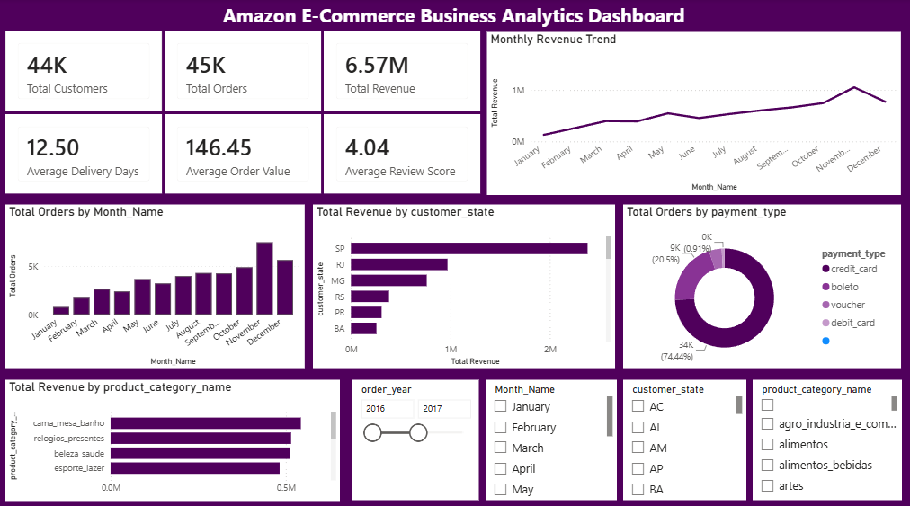
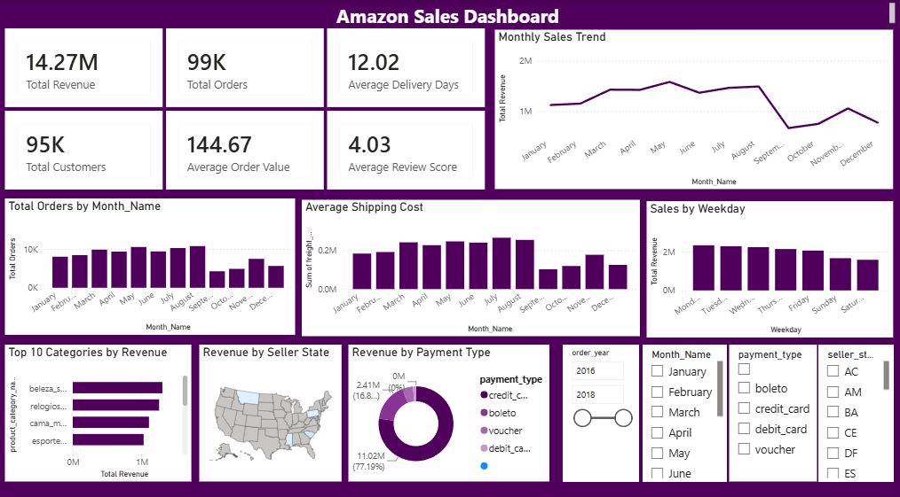
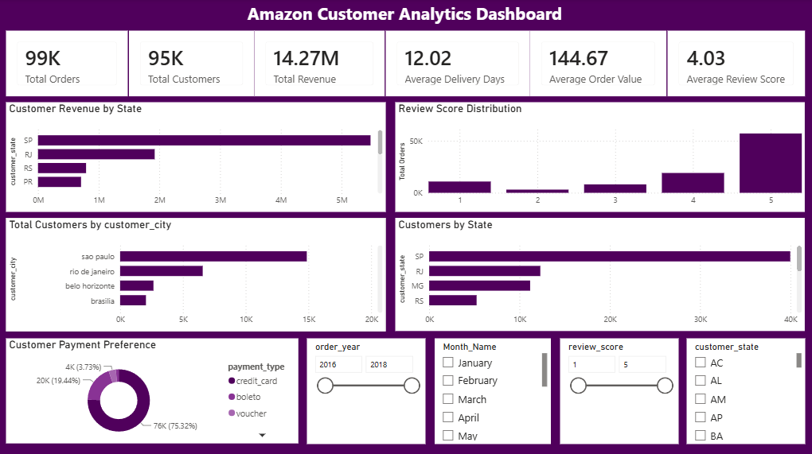
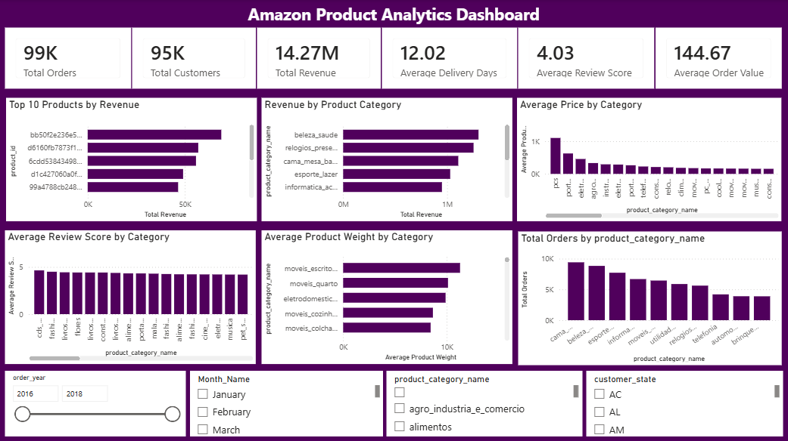

# Amazon E-Commerce Business Analytics

### End-to-End Data Analytics Project | Python · SQL · PostgreSQL · Power BI

## Project Overview

This project analyzes e-commerce data to explore sales performance, customer behavior, product categories, payment preferences, delivery performance, and customer satisfaction.

The workflow includes data preparation using Python, business analysis using SQL and PostgreSQL, and interactive dashboard development in Power BI.

**Dataset clarification:** Despite the project title, the data comes from the [Brazilian E-Commerce Public Dataset by Olist](https://www.kaggle.com/datasets/olistbr/brazilian-ecommerce), not from Amazon's internal systems.

## Tools & Technologies

- **Python:** Pandas, NumPy, data cleaning and preparation
- **SQL & PostgreSQL:** Joins, aggregations, CTEs, window functions, business analysis
- **Power BI:** Interactive dashboards, KPI cards, charts and slicers
- **DAX & Power Query:** Measures and data transformation
- **Git & GitHub:** Version control and project documentation

## Project Workflow

1. **Data Preparation:** Inspected, cleaned, transformed, and combined relevant datasets using Python.
2. **SQL Analysis:** Explored revenue, orders, customers, products, payment methods, and delivery performance.
3. **Data Visualization:** Developed four Power BI dashboards to present business metrics and comparisons.
4. **Reporting:** Documented the workflow, dashboard findings, and data-quality considerations.

## Power BI Dashboards

### 1. Executive Analytics Dashboard



Provides an overview of revenue, orders, customers, average order value, delivery time, review scores, and business trends.

### 2. Sales Analytics Dashboard



Explores monthly sales trends, weekday activity, product category revenue, seller locations, and payment methods.

### 3. Customer Analytics Dashboard



Analyzes customer geography, payment preferences, customer activity, and review-score distribution.

### 4. Product Analytics Dashboard



Compares product categories by revenue, order volume, average price, review scores, and product weight.

**[View the Complete Project Report (PDF)](./reports/Project_Report.pdf)**

## Key Business Findings

- **Payment preferences:** Credit cards account for approximately 75.32% of the displayed payment distribution, followed by boleto at 19.44%.
- **Customer geography:** São Paulo (SP) is prominent in the geographical visuals.
- **Customer satisfaction:** The Sales, Customer, and Product dashboards display an average review score of approximately 4.03/5.
- **Delivery performance:** These three dashboards display an average delivery time of approximately 12.02 days.
- **Product analysis:** Category-level visuals enable comparisons of revenue, order volume, pricing, and review scores.

> **Data-quality note:** The Executive Dashboard displays different KPI totals from the other three dashboards. These values need reconciliation before all four pages can be treated as a single consistent set of results.

## Repository Structure

```text
Amazon-Ecommerce-Business-Analytics/
├── README.md
├── dataset/
├── python/
├── sql/
├── powerbi/
└── reports/
    ├── dashboard_screenshots/
    │   ├── customer_dashboard.png
    │   ├── executive_dashboard.png.png
    │   ├── product_dashboard.png
    │   └── sales_dashboard.png
    └── Project_Report.pdf
```

## Business Value

The dashboards provide a consolidated view of sales, customers, products, payment preferences, delivery indicators, and customer feedback. These insights can support further investigation and data-driven business decisions.

## Future Improvements

- Reconcile KPI calculations across dashboards.
- Validate revenue and payment aggregations.
- Document SQL queries and DAX measures in greater detail.
- Expand customer segmentation and delivery analysis.

## Conclusion

This project demonstrates an end-to-end analytics workflow using Python, SQL, PostgreSQL, and Power BI to transform e-commerce data into structured analysis and interactive business reporting.

## Author

**Shagun Chauhan**

Data Analytics Portfolio Project

**Tech Stack:** Python · Pandas · NumPy · SQL · PostgreSQL · Power BI · DAX